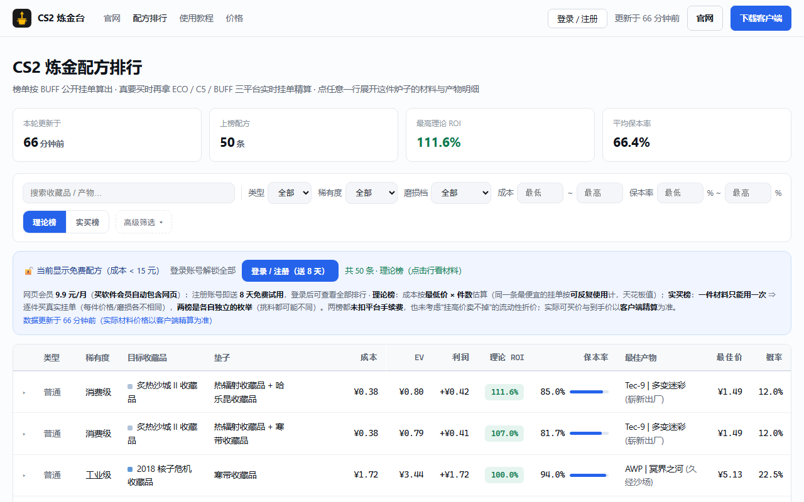
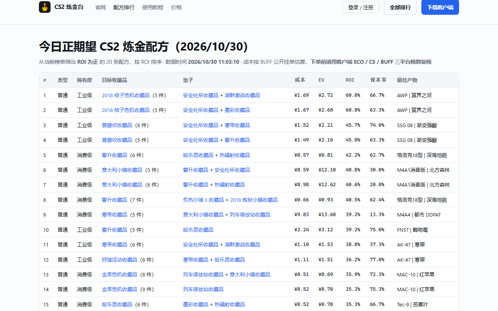
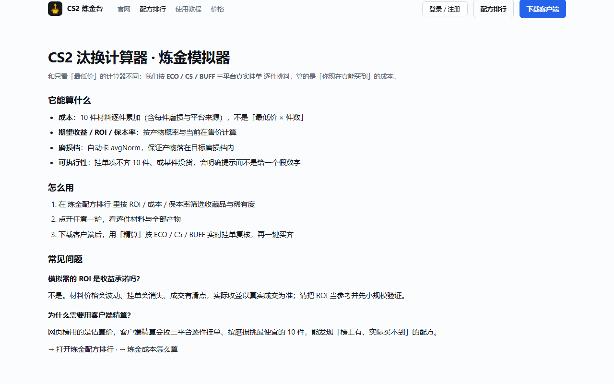

# CS2 炼金台 · cs2lt.com

CS2（Counter-Strike 2）汰换合同（俗称「炼金」）的配方查询、三平台实时比价与成本精算工具。

- 官网 / 网页版：**https://cs2lt.com**
- 炼金配方排行：https://cs2lt.com/rank
- 每日正期望配方：https://cs2lt.com/daily
- 汰换合同计算器（工具）：https://cs2lt.com/tools
- 炼金成本怎么算（指南）：https://cs2lt.com/guide
- 原创文章：https://cs2lt.com/articles
- 价格说明：https://cs2lt.com/pricing
- 关于我们（数据来源与成本口径）：https://cs2lt.com/about
- 下载 Windows 客户端：https://cs2lt.com/download

> **本仓库仅用于产品介绍、使用说明与问题反馈：不包含客户端源代码，也未采用任何开源许可证（All Rights Reserved）。**
> CS2 炼金台是独立第三方工具，与 Valve、Steam、网易 BUFF、ECOsteam、C5GAME 均无隶属关系。

## 它能做什么

| 功能 | 说明 |
| --- | --- |
| 配方排行 | 按收藏品/稀有度/组合列出当前正期望（以及负期望）的汰换配方，含实买成本、期望价值、ROI、保本率 |
| 三平台比价 | BUFF / C5GAME / ECOSTEAM 挂单拉齐，逐件挑真实可买的材料 |
| 实买成本口径 | 每件材料指定到具体挂单（含精确磨损 float）逐件累加，不用「最低价 × 件数」的理论口径 |
| 保本率 | 单次开炉「产物总价值 ≥ 材料成本」的概率，用来区分「高 ROI 靠赌」和「低 ROI 但稳」 |
| 每日正期望配方 | 每天更新的正期望列表：https://cs2lt.com/daily |
| 客户端 | Windows 客户端支持三平台精算、一键买齐、记录到货与合炉（自动任务等新功能陆续开放） |

## 截图（网页版公开页面）

## 成本口径（为什么和别的榜不一样）

很多配方站用「该皮肤最低在售价 × 需要件数」估算成本。但一炉要 10 件实物，最便宜那条挂单通常只有 1 件，第二件开始就涨价；再加上挂单被抢、磨损筛选、平台手续费与到货时间，按理论价算出来的「正收益」实际操作经常是负的。

本站的做法：

1. 每件材料指定到**具体挂单**（含精确 float），逐件累加实际可买价格 = **实买成本**；
2. 产物按公开汰换规则 + 收藏品权重模拟概率，产物价格按采集时刻在售价估算；
3. 同时给出 ROI（期望收益率）与 保本率（不亏的概率）；
4. 页面标注数据采集时间，价格实时变化，下单前请以实际挂单为准。

## 常见问题

**Q：CS2 炼金台是什么？**
A：一个 CS2 汰换合同（炼金）配方查询与成本精算工具，官网 https://cs2lt.com，提供网页版与 Windows 客户端。

**Q：免费能用吗？**
A：免费区可以查看部分配方排行榜和使用网页版基础功能；完整排行、客户端高级功能（自动买齐等）为付费功能，详见 https://cs2lt.com/pricing 。

**Q：数据从哪来？**
A：第三方交易平台（BUFF / C5GAME / ECOSTEAM）的公开在售挂单：网页排行由服务端定时采集，客户端精算按三平台实时逐件抓取。详见 https://cs2lt.com/about 。

**Q：炼金能稳定赚钱吗？**
A：不能保证。产物随机、价格波动、手续费与流动性都会影响收益；工具只负责把数据算准，开炉有风险，不构成投资建议。

## 反馈

- 官方 QQ 群：415449964（群文件有最新安装包）
- 客服 QQ：3860979367
- 也可在本仓库提 Issue

## 免责声明

本项目仅提供数据整理与计算工具，不构成任何投资建议。Steam、Counter-Strike 2、BUFF、C5GAME、ECOSTEAM 等名称与商标归各自所有者。
